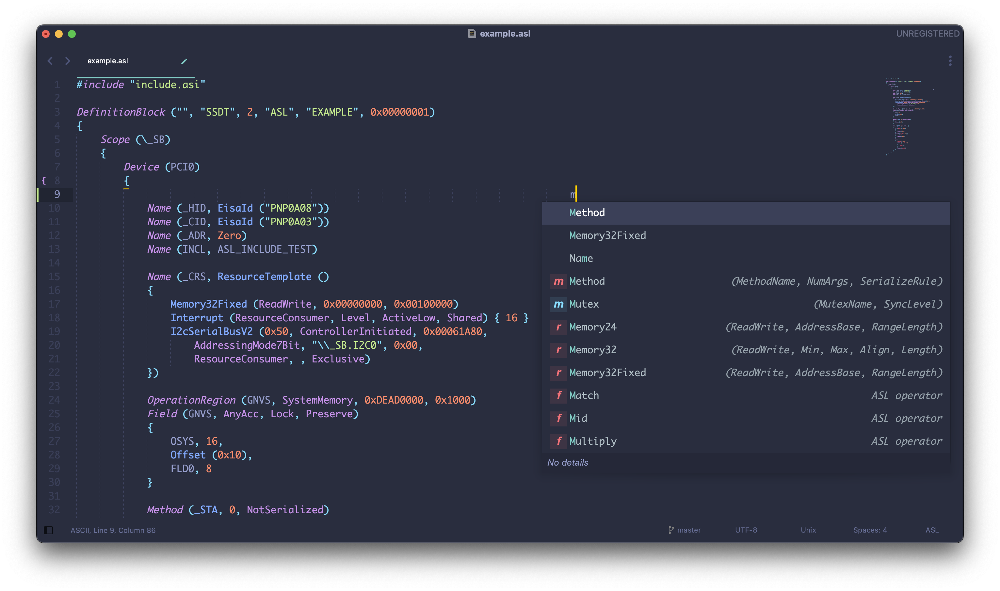

# ASL Syntax Highlight

Syntax highlighting and completions for the ACPI Source Language (ASL) in Sublime Text 4.

Requires **Sublime Text 4** (build 4000 or newer). The 1.x version for Sublime Text 3 is archived in the [`v1` branch](https://github.com/Fansaly/ASL-Syntax-Highlight/tree/v1).



## Features

- Highlights `.asl`, `.dsl`, and `.asi` files.
- ASL keywords are matched case-insensitively, as required by the ACPI specification.
- Keyword data is based on ACPI 6.6 and current ACPICA, including:
  - declarations and control flow
  - ASL operators
  - resource descriptor macros
  - field access, resource, and object-type flags
  - predefined `_` names
  - iASL preprocessor directives and built-in macros
- Builds symbol entries for `Method`, `Device`, `Scope`, `Name`, and other declarations.
- Provides completion snippets and descriptions for common ASL constructs, operators, resource macros, predefined names, and preprocessor directives.
- Supports indented/continued preprocessor directives.

## Install

- Via Package Control: search for `ASL Syntax Highlight`.
- Manual: clone this repository into your Sublime Text `Packages` directory and restart Sublime Text.

## Completions

Start typing an ASL keyword, operator, resource macro, or predefined name and press `Ctrl+Space` if the completion popup does not appear automatically. Declaration completions insert full blocks with tab stops, for example:

```asl
Method (MTHD, 0, NotSerialized)
{
}
```

## Development

See [`tests/README.md`](tests/README.md) for instructions on running the syntax tests.

## License

[MIT](https://opensource.org/licenses/MIT)
